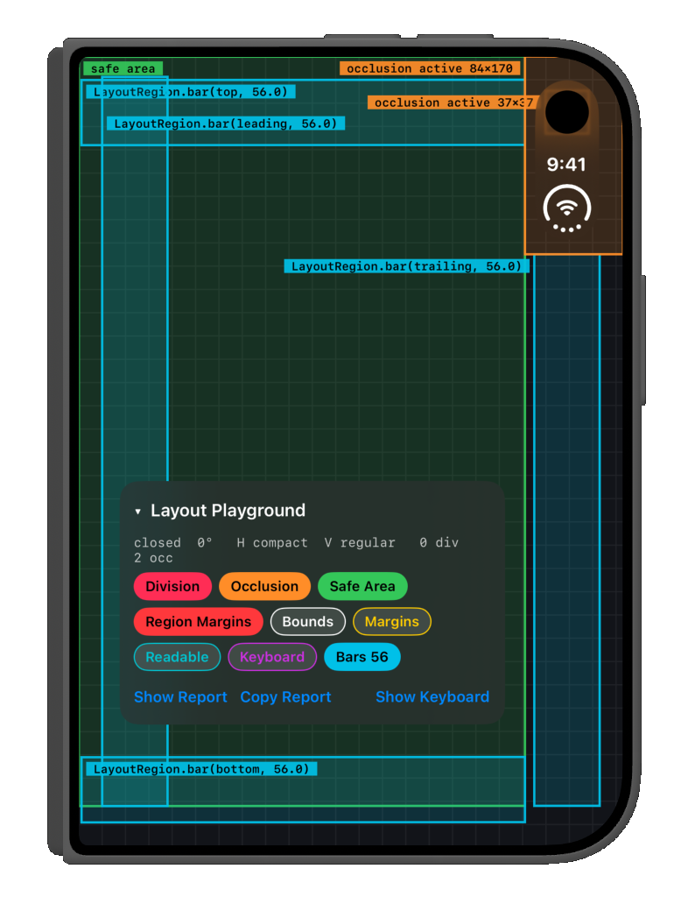
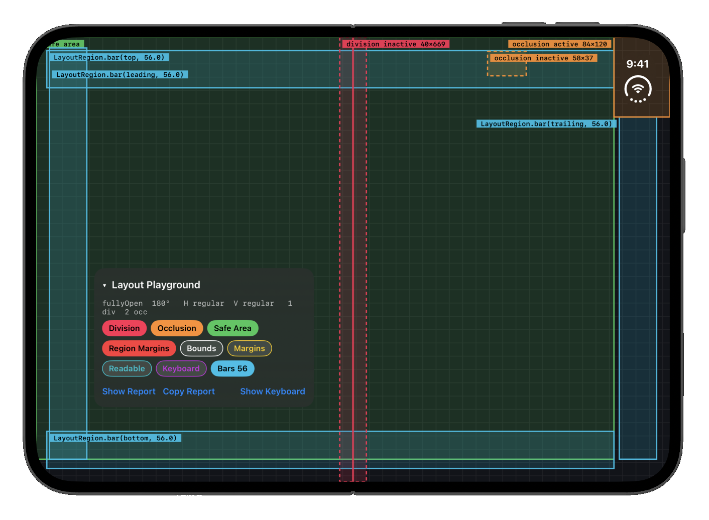

# ReservedRegions

A small UIKit playground for inspecting iOS 27 layout regions on a foldable iPhone: reserved regions (division and occlusion), safe area, margins, readable content, keyboard, and `UIView.LayoutRegion.bar` on all four edges.

  
  

## Usage

- Toggle overlay layers with the chips in the **Layout Playground** panel (drag the panel to move it, tap its header to collapse it).
- **Show Report** displays a text dump of every frame and inset. **Copy Report** copies it.
- **Show Keyboard** raises the keyboard so you can see `keyboardLayoutGuide`.
- Simulator: hold Option and drag to fold. On device, open, book-fold and close it.

## Requirements

- Xcode 27.1 or later (`UIView.LayoutRegion.bar` is new in the 27.1 SDK)
- iOS 27.1 deployment target

## Build

Open `ReservedRegions.xcodeproj`, choose your own signing team and bundle identifier, then run.
